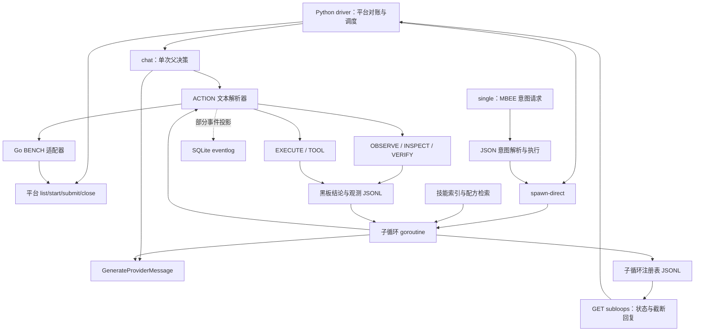

# OuroborosAgent 架构分析

核对日期：2026-11-02。依据当前源码、知识库文件、Go 入口构建及六个核心包的离线测试。历史评审中的场次、解题数和模型效果未在本轮复测。

## 核心判断

当前系统包含三条运行路径：Python 驱动的模型父子循环、任务编译与 worker 执行流水线、独立 GateMesh CLI 的规则传送带。它们共享部分 provider、工具、事件和黑板组件，但在授权、证据等级、预算、恢复和提交上使用不同契约。

最有价值的设计是：让模型基于原始观测推理，让后端控制工具执行；用有限子循环、进展摘要和脉冲重置控制上下文；用黑板保存结论和证据引用。当前可靠性的主要瓶颈在跨层接线：结果未返回、请求未完整保存、状态没有统一归属，以及相同名称的闸门具有不同语义。继续增加提示词之前，应先补齐这些契约。

## 1. 仓库边界与三条运行路径

本包保留 Go 核心、Python benchmark 驱动和知识库。目录没有 `gui/`、`Makefile`、`configs/`、`toolchains/`，但仍保留桌面工具链、TUI、工作台 HTTP 路由和大量协作/报告命令。根 `AGENTS.md` 与旧评审描述的是更大的工作台，需要结合当前源码使用。

实测 `cmd/` 与 `internal/` 共 406 个 Go 文件、217,096 行，其中 149 个测试文件、109,369 行测试；非测试源码 107,727 行。`cmd/ouro/main.go` 达 15,385 行，`internal/app/tui_snapshot.go` 达 9,177 行，独立 Agent 的提取尚未形成紧凑的业务边界。Go 内部导入路径核对未发现缺失包，入口可以构建。

| 路径 | 调度者与主要职责 | 模型参与 | 主要持久状态 |
|---|---|---|---|
| 默认 `OURO_DRIVE_MODE=orchestrated` → Python → `ouro serve` | Python 对账平台、补位、调用 chat 决策和直接派生子循环；API 执行动作 | 父决策和子循环使用 provider | `runtime/*.jsonl`、`replay/events.db`、Python 内存 |
| `ouro run <workspace>` | mission → compiler → 清单/工具计划 → swarm/worker → runner → parser → 回放和报告 | planner 可调用 provider | SQLite 事件、worker lease 与工作区工件 |
| `ouro agent run` | 选择最高分 conveyor 候选，直接调用工具，计步与验证 | 当前循环没有 provider 调用 | 根 `events.db`、SQLite execution leases、attempt 工件 |

`single` 模式通过 MBEE 意图 API 调度；`parent` 模式通过 chat 的 `ACTION:SPAWN/COLLECT` 调度。它们都进入 API 子循环运行时，并不自动接入独立 CLI 的全部 GateMesh 能力。

证据：[入口分发](../benchmark/parallel_entry.py)，[HTTP 路由 server.go:122](../internal/api/server.go)，[任务执行 run.go:703](../internal/app/run.go)，[独立 CLI agent_command.go:245](../cmd/ouro/agent_command.go)。

## 2. 默认 Agent 的数据流



一次典型执行如下：

1. Python 拉取平台题单，启动容器。每个有活跃目标的周期仍先同步调用 chat 获取一行决策，再执行默认调度。这里模型超时会延迟默认策略；无分析回复也不意味着零等待。
2. `spawn-direct` 绕过模型回显动作这一环，直接调用 `spawnSubLoop`。子循环拿到目标、相关黑板事实、词法技能和配方片段。
3. 子循环最多 40 轮；每五轮携带 PROGRESS 摘要；脉冲边界按 12 轮检查收据并构造新上下文。其持续记忆来自上一轮动作结果、摘要和黑板种子，未持续传入完整聊天 Messages。
4. `OBSERVE` 保存原始观测，向模型返回小摘要；`INSPECT` 提供局部证据切片。模型通过 `BLACKBOARD` 写结论，通过 obs ID 建立回链，通过 `VERIFY` 尝试晋升等级。
5. 子循环结束后写 registry 与完成通知。driver 拉取 `/subloops`，根据 `lastReply` 提取候选 flag，并有独立的 Python 提交分支。

证据：[drive_orchestrated.py:156、268、383](../benchmark/drive_orchestrated.py)，[subloop.go:288、333、449](../internal/api/subloop.go)，[ai_chat.go:785](../internal/api/ai_chat.go)。

## 3. 模型、上下文与知识层

### Provider 是共享入口，调用策略分散在上层

`GenerateProviderMessage` 每次加载 provider 配置，筛选能力，按配置采用首个匹配或顺序 failover；瞬态网络错误有 3s/9s 退避重试。在线生成适配器为 OpenAI-compatible，GLM/DeepSeek 通过兼容协议和型号配置使用。

`tier=1` 只有在 `OURO_TACTIC_MODEL` 设置时替换型号；其他 tier 使用 provider 原型号。连接配置与型号的价格、能力、context window 没有完全分开。主 chat、MBEE、子循环均没有接入共享的累计 token/cost 账本；单次 token 上限、回合和时间上限确实存在。

MBEE 当前是非流式、tier=1、2048 token 请求，生成完整回复后再提取/修复 JSON。所谓 330 字信封是提示与返回值处理的约束，不是当前传输层即时截断。`StreamWithRootJSONGuillotine` 有实现但无调用点。普通子循环的单次请求上限为 65,536 tokens，有限回合不能直接替代金额预算。

证据：[provider_generation.go:74、144、193、723](../internal/app/provider_generation.go)，[mbee_intent.go:58](../internal/api/mbee_intent.go)，[subloop.go:365](../internal/api/subloop.go)，[provider_usage.go:112](../internal/app/provider_usage.go)。

### 主 chat 的日志与模型记忆分离

POST chat 保存用户/助手消息，但调用模型时传入的是当前 message 和工作区摘要，没有读取会话历史。GET chat 可以返回历史给客户端。子循环完成通知写入 conversation，但主 chat 的下一次模型请求不会因此自动获得通知；父循环需要 driver 主动转注子循环状态。

工作区摘要从黑板取前 15 条事实，而非按当前目标查询最新相关事实；同时夹带报告、harness、旧 agent 任务、文件和工具链信息。这解释了上下文为何可能重复、失焦或丢失近期结论。它是源码支持的机制解释，尚未据此量化模型效果。

证据：[ai_chat.go:85、98、178、282](../internal/api/ai_chat.go)，[subloop.go:502](../internal/api/subloop.go)。

### 知识库完整，命中机制是词法与位掩码启发式

当前知识包有 79 个 `SKILL.md`、79 条索引和 1,889 个配方节点，所有索引路径存在。API 提供两套检索：技能索引的关键词/CJK 别名匹配，以及自由文本 → 12 维攻击面位掩码 → 前置覆盖至少 70% → tag 加权排序的配方匹配。

当前没有 embedding 或图遍历；配方节点的 `exclude` 均为零。输入含目标描述和模型上一轮回复，因此“计划测试认证”可能与“已经证实认证攻击面”映射为同一位。检索结果适合作为候选提示，尚不能视为经过证据验证的路径前置条件。

检索每次重读 JSONL，读取/解析错误可以静默退化。独立 CLI 又尝试读取可选 `kb_vectors.db`，这个数据库不在当前 KB 包中。应统一检索接口并暴露健康状态、版本、命中理由；黑板继续保存事实与结论，不承担推理调度算法。

证据：[kb_retrieval.go:40、108](../internal/api/kb_retrieval.go)，[hypergraph.go:94、178、204](../internal/api/hypergraph.go)，[agent_command.go:199](../cmd/ouro/agent_command.go)。

## 4. 状态所有权与实际保障

| 状态 | 当前所有者 | 主要边界 |
|---|---|---|
| `replay/events.db` | 工作区 API/mission | WAL、单连接写入；部分 chat 内容镜像为事件 |
| conversation、observations、blackboard JSONL | API Server 的 `stateMu` | 同一 Server 内串行；与 SQLite 无跨存储事务 |
| subloop registry | 进程全局 map，加工作区 JSONL journal | 名字键没有 workspace；恢复仅在 COLLECT 时加载 |
| TCE 去重 | 进程全局 map | workspace/session 未进键；缓存没有淘汰 |
| Sisyphus 未核销观测 | Server 内存 | 父子共享；启动不从持久日志重建 |
| 平台调度/提交集合 | Python 进程内存 | 与子循环 journal、Go BENCH 审计各自独立 |
| 独立 CLI execution lease | 根 `events.db` | 独立的四阶段幂等租约与崩溃恢复 |

因此，“SQLite 是全部 Agent 状态的唯一真值”不符合当前默认运行路径。它对 mission 事件与投影有重要地位；默认 Agent 的控制状态仍分布在 JSONL 和内存中。

`Server.Stop` 会停止已登记的执行、关闭 HTTP、等待 `execWG` 再关闭事件库，这一执行关闭顺序是合理的。但子循环从 `context.Background()` 派生，没有登记到该生命周期，停止服务器不会统一取消或等待它们。

证据：[sqlite.go:23](../internal/eventlog/sqlite.go)，[server.go:31、172](../internal/api/server.go)，[subloop.go:82、291、734](../internal/api/subloop.go)，[tce_gate.go:41](../internal/api/tce_gate.go)。

## 5. 优先问题与具体影响

以下 P1 表示优先处理的执行/证据正确性问题，P2 表示后续架构整合问题，不代表已完成漏洞扫描。

### P1：机器结果与提交闭环缺失

`LastResult` 在子循环终态生成，但 `/subloops` DTO 和持久化 journal 均不返回它。driver 仍解析最多 1,000 字节的 `lastReply`。40 轮用完也可能标记 `done`，`done` 因而只表示循环结束；结果构造又从整个工作区的任意新 flag 判断成功，未绑定目标或平台接受结果。

Python 的 `submitted` 按题目 code 去重，拒绝提交后也加入集合，影响同题多 flag 和候选重试。ACCEPTED 分支引用未初始化的 `flags_won`，会在平台已接受后进入本地异常处理。driver 与子循环都能直接提交，缺少统一的证据引用、候选身份和幂等记录。

应返回明确的结果协议：目标/loop ID、终止原因、候选和 observation 引用、已验证结论、提交回执。区分 `completed/exhausted/cancelled/hibernated`；提交由一个平台适配器管理，以目标与候选组合记录状态。

证据：[subloop.go:493、667、706、891](../internal/api/subloop.go)，[drive_orchestrated.py:399、409、414](../benchmark/drive_orchestrated.py)。

### P1：E3 的语义与来源在跨层转换中丢失

API VERIFY 没有保存原请求 spec，重放使用普通 GET，POST、body、header 和鉴权上下文可能消失；它以观测 JSON 中的子串命中为通过条件，并晋升所有引用该 obs 的事实。一个响应里的某个信号并不能验证引用它的全部结论。

独立 `evidencegate` 支持正负对照，但当前 CLI 传入空 ExpectedSignal，成功重放也保持 E2。API → planner 的 journalFact 转换未携带 EvidenceLevel，证据图投影也未保留该等级或 observation→fact 边。相同 E3 标签无法作为跨入口稳定的依赖条件。

应保存可重放请求描述，验证具体 fact 的具体断言，记录正样本和适用的对照样本；将等级和 provenance 全程带入 planner/report。请求重放的敏感字段需要引用或脱敏存储，不能把密钥写入报告。

证据：[evidence_gate.go:107、128](../internal/api/evidence_gate.go)，[evidencegate.go:108](../internal/evidencegate/evidencegate.go)，[agent_command.go:381](../cmd/ouro/agent_command.go)，[observation_journal.go:94](../internal/app/observation_journal.go)，[projector.go:14](../internal/evidence/projector.go)。

### P1：运行模式切换会改变策略保证

API OBSERVE 使用 URL 目标校验，EXECUTE 从命令文本提取明文 HTTP(S) URL；mission 使用另一套目标、参数和路径检查；独立 CLI 注入 guarded HTTP transport。裸 TCP handler 和外部 subprocess 不自动继承这个 HTTP transport。

默认 orchestrated driver 还生成 `target_policy: disabled` 与对应授权文件，并直接通过 Python 请求平台；这些调用不经过 Go BENCH 的候选证据检查、拒绝值熔断和审计路径。源码具备授权闸门，但当前默认 benchmark 配置使用的是具体部署模式的授权策略。

应共享类型化的 PolicyContext，并让 HTTP/TCP/subprocess 适配器明确执行边界。命令字符串检查不能代表物理网络隔离；需要严格网络边界的模式应在 transport 或执行隔离层落实。所有平台提交也应复用同一个审核/审计接口。

证据：[observe_scope.go:21](../internal/api/observe_scope.go)，[egress_gate.go:61](../internal/api/egress_gate.go)，[agent_command.go:120、519](../cmd/ouro/agent_command.go)，[drive_orchestrated.py:199、403](../benchmark/drive_orchestrated.py)，[conveyor.go:303](../internal/api/conveyor.go)。

### P1：进展、休眠与升级状态转移存在具体偏差

脉冲边界先把收据写成新的黑板事实，再统计事实数判断是否零产出；收据自身可以阻止 sterile 累积。进展统计和 flag 判据读取整个工作区，同伴子循环的事实也会被当成本循环进展。

forced-pivot 将 `flagshipTurn` 置 true 后，同一轮末尾立即清成 false，下一轮不会因此升级 L2；DONE 驳回分支因为 `continue` 可以保留升级。策略名称与实际状态转移不一致。

应按 loop/目标统计新增证据或状态变化，把管理收据与领域发现区分；显式保存并在下一次请求构造时消费 `nextTurnPolicy`。休眠只结束当前循环，不应自动等同于题目已完成或无可行路径。

证据：[subloop.go:335、477、485、491、854](../internal/api/subloop.go)。

### P2：去重键、生命周期和协议不完整

TCE 指纹缺少 headers、content type、URL 自带 query、workspace 和鉴权 session。仅参数或身份不同的请求可能被合并；缓存中的 obs ID 来自产生它的工作区。应对实际展开后的请求进行规范化，按工作区/session 限定缓存并设置上限。

子循环 registry 应属于工作区运行时；启动时加载历史，把被中断的运行明确标记，恢复时保留结果、tier、pulse 和负约束。当前 COLLECT 加载历史并改为 cancelled 是“识别中断”，尚不等于续跑恢复。

`ACTION:QUERY` 出现在提示和错误指引中，但文本 dispatcher 没有对应分支；HTTP 黑板查询已经存在。动作在“回复开头”与“回复末尾”的提示还互相冲突。应该由同一动作 schema 生成提示、解析和校验，保留文本协议作为兼容适配器。

证据：[tce_gate.go:57](../internal/api/tce_gate.go)，[subloop.go:594、734](../internal/api/subloop.go)，[ai_state.go:102](../internal/api/ai_state.go)，[ai_chat.go:141、168](../internal/api/ai_chat.go)，[autonomy.go:20](../internal/api/autonomy.go)。

## 6. 建议的目标边界与迁移顺序

建议保留模型观测推理、共享黑板和原有 parser 输出契约，将运行时职责收敛为下列边界：

| 边界 | 单一职责 |
|---|---|
| Driver / HTTP / CLI adapters | 接收任务或平台状态，调用统一运行时；不复制证据/预算规则 |
| Orchestrator | 持有目标、子循环生命周期、并发槽位、取消、恢复和终态 |
| DecisionAdapter | 将 MBEE、ACTION 文本或未来结构化调用转为同一类型化动作 |
| ModelRuntime | 型号选择、调用前预算预留、调用后 usage 结算、内容/思考通道和重试 |
| ExecutionService | 授权上下文、完整请求、执行隔离、取消、原始观测与工件 |
| EvidenceStore / Verifier | 观测→断言→验证记录→结果的稳定关联与投影 |
| KnowledgeRetriever | 按显式目标/观测状态返回候选材料与命中理由 |
| PlatformAdapter | 平台五操作、提交证据、拒绝候选、幂等和回执 |

迁移分四步，避免同时改变调度算法与模型提示：

1. **先闭合结果协议。** 对现有 DTO 增加版本化结果与 provenance 字段，统一终态原因和候选提交状态；保留原 `lastReply` 供兼容与审计。
2. **统一生命周期和观测记录。** 将 subloop/TCE 状态归入工作区运行时，父 context 取消所有子执行；保存完整重放描述。原 JSONL 可以作为兼容投影，逐步明确持久真值。
3. **接入共享闸门。** 让 chat、MBEE、子循环都调用 ModelRuntime；优先统一 VERIFY 和平台提交，再逐 operation 接入 ExecutionService。保持 managed/native 的 parser 字节兼容与现有授权检查。
4. **再做策略实验。** 对比“默认驱动＋限时父决策”和 MBEE 调度，分别测动作格式错误、重复观测、首个有效证据耗时、目标完成率、恢复成功率和 token/有效发现。一次只改变一个因素。

每步应可通过兼容适配器回退，新增字段不破坏旧事件/DTO；旧 journal 迁移按版本处理。验证使用真实临时工作区和本地 `httptest`，优先覆盖请求重放、并行目标归属、重启恢复、取消、同题多候选提交与预算结算。黑板保持存储/检索角色，调度由明确的运行时与模型决策接口负责。

## 7. 验证与部署限制

本轮通过：

```sh
# 使用已有 Go 1.26.2 工具链，GOPROXY=off，未连接外部 provider/目标
go build -o tmp/agent-architecture-20261102/ouro.exe ./cmd/ouro
go test ./internal/api ./internal/eventlog ./internal/cognition \
  ./internal/blackboard ./internal/scopegate ./internal/evidencegate
```

入口构建成功，六包测试通过；没有运行全量测试、Docker 构建或真实 benchmark。包测试通过证明已有局部契约可用，不能证明默认 driver 到证据验证/平台回执的整条链路正确。

Dockerfile 使用宿主预构建二进制和离线 wheel，这是显式构建前置条件。它还无条件 COPY 当前不存在的 `benchmark/drive_autonomous.py`，因此即使选默认 orchestrated，当前 Docker 构建仍会因这个源文件缺失而失败；未知入口模式也会落到缺失的 sharded 脚本。应单独修复打包完整性并拒绝未知模式。

证据：[Dockerfile:18、30](../Dockerfile)，[parallel_entry.py:31](../benchmark/parallel_entry.py)。本轮只新增分析文档与被忽略的临时核对材料，没有修改 Agent 源码、授权策略或根 AGENTS.md。
